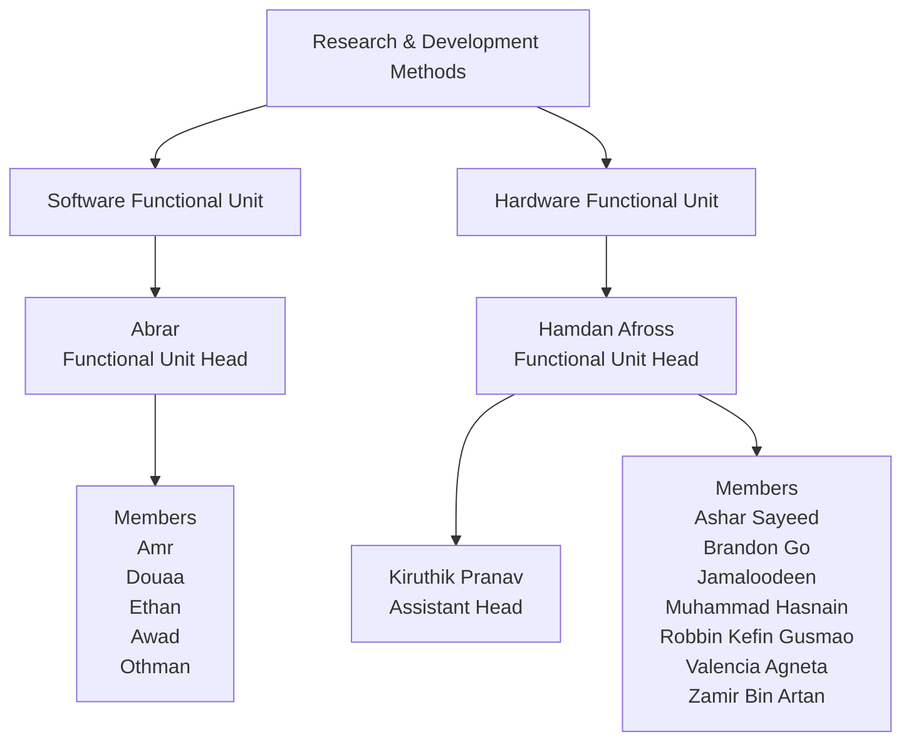

# Research & Development Methods

Welcome to the GitHub organization for APU’s Technical Assistants in the **Hardware & Software Functional Unit**.

We use this space to collaborate on hardware and software projects, document what we learn from technical investigations, and share tools and procedures that other Technical Assistants can reuse.

## Functional unit hierarchy

